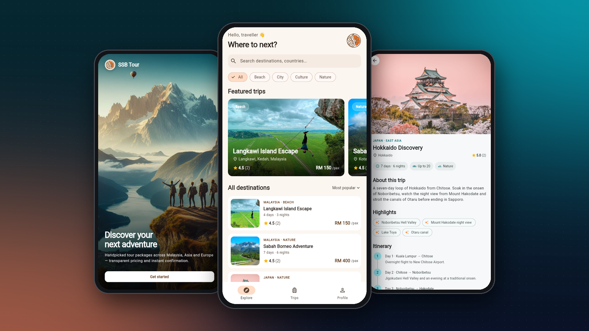
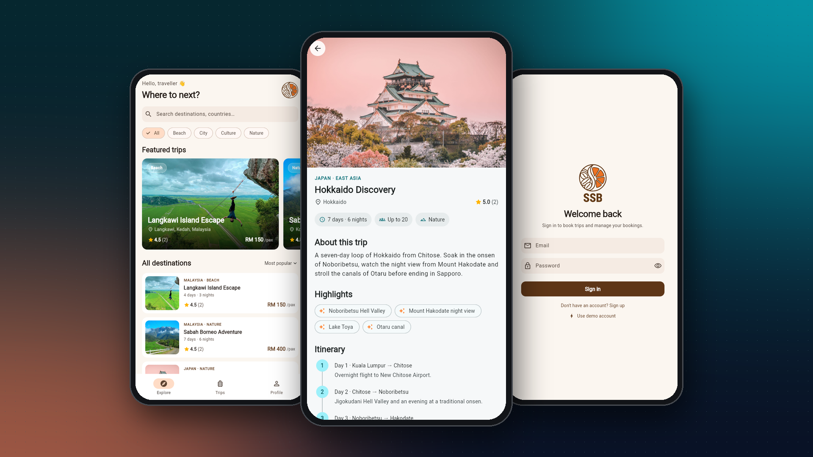
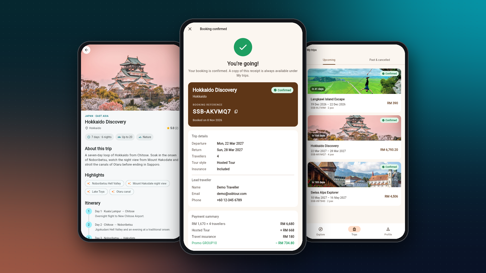

<p align="center"></p>

# SSB Tour — Tour Package Booking

A full-stack mobile app for browsing and booking holiday tour packages, built with **Flutter** and a **Node.js + TypeScript REST API**.

Travellers can browse destinations, view detailed itineraries and reviews, book a trip through a multi-step checkout with live server-side pricing and promo codes, then manage their bookings and leave reviews.

<p align="center">
  
</p>

<p align="center">
  
</p>

<p align="center">
  
</p>

## Features

**App (Flutter)**
- Explore screen with debounced search, category filters, sorting and a featured-trips carousel
- Package details: hero image, highlights, a day-by-day itinerary, inclusions and traveller reviews
- 3-step booking wizard: date, travellers, tour style, insurance → contact details → review, promo code and confirmation
- Live price quotes from the server while the traveller changes options
- My trips: upcoming / past tabs, booking receipt, free-cancellation rule, star ratings and reviews
- Sign up / sign in with a persisted session, guarded routes and a redirect back to the booking in progress
- Material 3 design system with light and dark themes, skeleton loaders, empty/error states and pull-to-refresh

**API (Node.js)**
- REST API built with Express 5 and TypeScript, using SQLite (`node:sqlite`, so no native build step)
- JWT authentication, bcrypt password hashing, role-based admin endpoints
- Request validation with Zod and consistent JSON error responses
- **Server-authoritative pricing**: amounts are integers in sen, and prices sent by the client are ignored
- Business rules: minimum booking notice, group-size limits, promo code conditions, 3-month (90-day) cancellation window, one review per booking
- Security middleware: Helmet, CORS allow-list, rate-limited auth endpoints
- 21 integration and unit tests (`node:test` + Supertest)

## Architecture

```
┌──────────────────────────┐        HTTPS / JSON        ┌─────────────────────────────┐
│  Flutter app             │ ─────────────────────────▶ │  Express API (TypeScript)   │
│  features/  (screens)    │                            │  routes/   auth, packages,  │
│  state/     (Riverpod)   │ ◀───────────────────────── │            bookings, admin  │
│  data/      (repos/models)│      JWT bearer token     │  lib/      pricing engine   │
│  core/      (API client) │                            │  db/       SQLite + seed    │
└──────────────────────────┘                            └─────────────────────────────┘
```

| Layer | Tech |
| --- | --- |
| Mobile app | Flutter 3, Dart 3, Riverpod 3, go_router, http, shared_preferences, intl |
| API | Node.js 22+, Express 5, TypeScript, Zod, jsonwebtoken, bcryptjs, Helmet |
| Database | SQLite via `node:sqlite` (WAL mode, foreign keys, indexes) |
| Quality | `flutter analyze`, widget tests, `node:test` + Supertest, GitHub Actions CI |

```
.
├── lib/
│   ├── core/        # config, theme, API client, formatting
│   ├── data/        # models + repositories
│   ├── state/       # Riverpod providers (auth, catalogue, bookings)
│   ├── features/    # welcome, home, package, booking, trips, auth, profile
│   ├── widgets/     # shared UI components
│   └── router.dart  # routes + auth guard
├── backend/
│   ├── src/         # app, routes, middleware, pricing, db
│   └── tests/       # API integration + pricing unit tests
└── test/            # Flutter unit & widget tests
```

## Getting started

### 1. Run the API

```bash
cd backend
npm install
cp .env.example .env     # optional — sensible defaults are built in
npm run dev              # http://localhost:4000
```

On first start in development the database is created and seeded with 9 tour packages, promo codes, sample reviews and two demo accounts:

| Role | Email | Password |
| --- | --- | --- |
| Customer | `demo@example.com` | `Password123!` |
| Admin | `admin@example.com` | `Admin123!` |

Reset the database at any time with `npm run seed -- --reset` (disabled in production).

> These demo accounts only exist when `SEED_DEMO_DATA` is on, which is the default outside production. With `NODE_ENV=production` only the tour catalogue is seeded.

### 2. Run the app

```bash
flutter pub get
flutter run                                   # Android emulator uses http://10.0.2.2:4000 automatically
flutter run -d chrome                         # web / desktop use http://localhost:4000
flutter run --dart-define=API_BASE_URL=https://your-api.example.com
```

### Tests

```bash
cd backend && npm test        # API
flutter test                  # app
```

## API reference

All responses are JSON. Errors have the shape `{ "error": { "code", "message", "details?" } }`.

| Method | Endpoint | Auth | Description |
| --- | --- | --- | --- |
| GET | `/api/health` | — | Health check |
| POST | `/api/auth/register` | — | Create an account → `{ token, user }` |
| POST | `/api/auth/login` | — | Sign in → `{ token, user }` |
| GET / PATCH | `/api/auth/me` | User | Current profile / update name & phone |
| GET | `/api/packages` | — | List packages: `q`, `region`, `category`, `maxPrice`, `sort` |
| GET | `/api/packages/options` | — | Regions, categories, tour types, insurance price |
| GET | `/api/packages/:slug` | — | Package details with itinerary |
| GET | `/api/packages/:slug/reviews` | — | Package reviews |
| POST | `/api/quotes` | — | Price a trip (validates dates, group size, promo) |
| POST | `/api/bookings` | User | Create a booking |
| GET | `/api/bookings` | User | My bookings |
| GET | `/api/bookings/:reference` | Owner | Booking details |
| POST | `/api/bookings/:reference/cancel` | Owner | Cancel (≥ 90 days before departure) |
| POST | `/api/bookings/:reference/review` | Owner | Rate the trip (once per booking) |
| GET | `/api/admin/stats` | Admin | Revenue, bookings, top packages |
| GET | `/api/admin/bookings` | Admin | All bookings (`status`, `limit`, `offset`) |
| PATCH | `/api/admin/bookings/:reference` | Admin | Update booking status |

### Pricing rules

```
base       = price per pax × travellers
tour style = base × (Independent 0% · Hosted +10% · Escorted +20% · Freedom −10%)
insurance  = RM 45 × travellers (optional, never discounted)
discount   = (base + tour style) × promo %
total      = base + tour style + insurance − discount
```

| Promo code | Discount | Condition |
| --- | --- | --- |
| `WELCOME5` | 5% | — |
| `GROUP10` | 10% | 4+ travellers |
| `EARLYBIRD20` | 20% | Departure 60+ days away |

These are demo codes, seeded only in development. Production starts with no promo codes, so create your own instead of reusing these public ones.

## Deployment

The API ships with a multi-stage `backend/Dockerfile`. Set `JWT_SECRET` and mount a volume at `/data` to persist the SQLite database:

```bash
docker build -t ssb-tour-api backend
docker run -d --name ssb-api -p 127.0.0.1:4000:4000 -e JWT_SECRET=$(openssl rand -hex 32) -v ssb-data:/data ssb-tour-api
```

The port is bound to `127.0.0.1` so the API is never served over plain HTTP. Put it behind a reverse proxy that terminates HTTPS (e.g. Caddy or Nginx), and set `CORS_ORIGIN` only if a web version of the app calls the API from a browser.

Production starts with no user accounts and no demo data. Create your admin account without typing the password into a command, so it stays out of your shell history:

```bash
read -rp 'Admin email: ' ADMIN_EMAIL; read -rsp 'Admin password: ' ADMIN_PASSWORD; echo
export ADMIN_EMAIL ADMIN_PASSWORD
docker exec -e ADMIN_EMAIL -e ADMIN_PASSWORD ssb-api node dist/db/create-admin.js
unset ADMIN_PASSWORD
```

Locally, run `npm run create-admin` in `backend/` with the same two variables set.

## License

MIT
